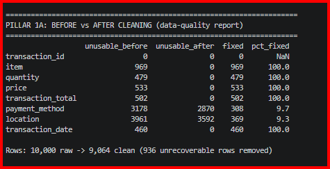
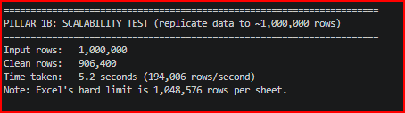
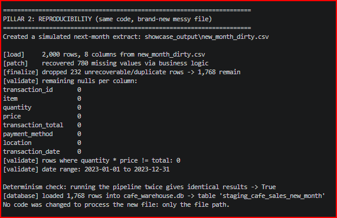
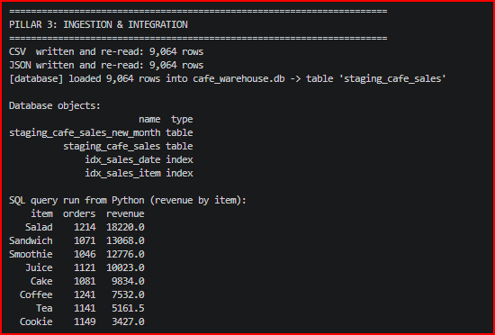

# Café Sales Analytics Pipeline

An end-to-end data project that takes a deliberately messy café sales file and turns it into clean, analysis-ready data, a SQL database, and (in later phases) dashboards. Each tool has one clear job: **Python** cleans and loads the data, **SQL** builds the analytical views, **Excel**, **Power BI** and **Tableau** present the results.

## Business scenario

A café's point-of-sale export contains missing prices, placeholder text such as `ERROR` and `UNKNOWN`, inconsistent formatting and broken totals. Reporting directly from this file would give wrong answers. The goal is a repeatable pipeline that cleans each new export automatically and feeds reliable numbers to the people who make decisions about the menu, pricing and staffing.

## Dataset

- **Source:** Kaggle, "Cafe Sales - Dirty Data for Cleaning Training" (synthetic data created for practice)
- **Size:** 10,000 rows, 8 columns
- **Columns:** Transaction ID, Item, Quantity, Price Per Unit, Total Spent, Payment Method, Location, Transaction Date
- **Known problems:**
  - Placeholder values (`ERROR`, `UNKNOWN`) and blank cells in several columns
  - Missing prices, quantities and totals
  - Numbers and dates stored as text
  - Inconsistent spacing and capitalisation

## Pipeline

```
dirty_cafe_sales.csv  ->  Python (clean)  ->  clean_cafe_sales.csv + SQLite database
                                                       |
                                  SQL views  ->  Excel / Power BI / Tableau
```

## Phase 1: Python ETL (`cafe_etl.py`)

The script is split into small functions, one per cleaning step, and one `clean_pipeline()` function runs them in order.

| Step | Function | What it does |
|---|---|---|
| Load | `load_raw` | Reads the CSV as text so nothing is silently changed |
| Rename | `standardize_columns` | Converts column names to `snake_case` |
| Clean text | `clean_text` | Trims spaces, fixes capitalisation, turns placeholders into real missing values |
| Convert types | `convert_types` | Converts text to numbers and dates |
| Patch gaps | `patch_gaps` | Recovers missing values using `total = quantity x price` and the menu's fixed prices |
| Finalise | `finalize` | Drops unrecoverable rows, labels missing payment method and location as `Unknown`, removes duplicates |
| Validate | `validate` | Reports remaining blanks and any rows where the maths does not match |
| Output | `export_csv`, `load_to_sqlite` | Writes `clean_cafe_sales.csv` and the `cafe_warehouse.db` SQLite database |

### Design decisions

- **Recover before deleting.** Values are rebuilt from related columns where it is safe to do so. Only rows that cannot be recovered are removed.
- **No guessing for descriptive fields.** Missing payment method and location cannot be inferred reliably, so they are labelled `Unknown` rather than invented.
- **Item is inferred from price only when unambiguous.** A price that belongs to more than one item is not used to guess the item.
- **Validation after cleaning.** The script reports how many rows still fail the quantity x price check, so the quality of the result can be checked.

### Results

Replace the numbers below with the output from your own run.

| Measure | Result |
|---|---|
| Raw rows | 10,000 |
| Rows after cleaning |  9,064 clean (936 unrecoverable rows removed) |

## Evidence: Screenshots from a Real Run

### Data quality: before vs after cleaning


### Scale test (about 1,000,000 rows)


### Reproducibility check


### Revenue by item (SQL query run from Python)


Full output: [results/showcase_log.txt](results/showcase_log.txt)

### Reproducibility

The same code runs on any new export:

```
python cafe_etl.py path/to/new_file.csv
```

`python_showcase.py` demonstrates this by cleaning a simulated "next month" file with no code changes, checking that two runs give identical results, and timing the pipeline on about one million rows.

## How to run

1. Install Python 3.10 or newer.
2. Create a virtual environment and install the packages:

```
python -m venv .venv
.venv\Scripts\python.exe -m pip install pandas numpy
```

3. Put `dirty_cafe_sales.csv` in the project folder.
4. Run the pipeline:

```
.venv\Scripts\python.exe cafe_etl.py
```

This creates `clean_cafe_sales.csv` and `cafe_warehouse.db`. (The database file is not stored in this repository; it is rebuilt by running the script.)

## Project roadmap

- [x] Phase 1: Python ETL
- [ ] Phase 2: SQL views (CTEs, window functions, conditional aggregation)
- [ ] Phase 3: Excel (Power Query, pivot tables, scenario planner)
- [ ] Phase 4: Power BI (star schema, DAX measures, operational dashboard)
- [ ] Phase 5: Tableau Public (visual story)

## Skills demonstrated

Python (pandas, numpy, sqlite3), data cleaning, data validation, SQL, version control with Git and GitHub. More will be added as each phase is completed.

## Author

Taseen Shafquat  | [Linkedin: https://www.linkedin.com/in/taseen-shafquat/]
[Portfolio Site: https://marketlitics.vercel.app/]
